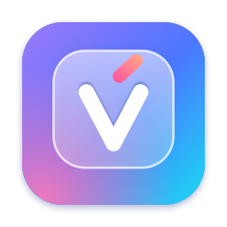

<p align="center">
  
</p>

<h1 align="center">Mr TV</h1>

<p align="center"><b>Tiếng Việt, gõ là đúng.</b><br>
Bộ gõ tiếng Việt miễn phí, mã nguồn mở cho macOS — gõ chuẩn ở mọi ứng dụng, và đủ thông minh để sửa giúp bạn.</p>

<p align="center">
  
  
  
  
  <a href="LICENSE"></a>
  <a href="https://github.com/mrtungdev/mrtv/actions/workflows/ci.yml"></a>
</p>

<p align="center">
  <a href="#tải-về-và-cài-đặt">Tải về</a> ·
  <a href="#cách-sử-dụng">Cách sử dụng</a> ·
  <a href="#câu-hỏi-thường-gặp">Câu hỏi thường gặp</a> ·
  <a href="CONTRIBUTING.md">Đóng góp</a> ·
  <a href="docs/huong-dan-su-dung.md">Hướng dẫn đầy đủ</a>
</p>

> **Trạng thái:** bản 0.1 đang thử, chưa có bản phát hành chính thức. Bạn có thể [build từ mã nguồn](#build-từ-mã-nguồn) để dùng.

---

## Giới thiệu

Gõ tiếng Việt trên Mac vẫn còn nhiều chuyện khó chịu: chữ đang gõ bị gạch chân, mất hoặc nhân đôi ký tự trên thanh địa chỉ trình duyệt và trong VS Code, từ tiếng Anh bị biến thành chữ vô nghĩa, có lúc bộ gõ ngừng hẳn cho tới khi đăng xuất.

Mr TV giải quyết bằng ba điều:

| | |
|---|---|
| **Chuẩn ở mọi nơi** | Chọn sẵn cách gõ cho từng ứng dụng. Ứng dụng của Apple dùng bộ gõ chuẩn của macOS, không gạch chân. Chrome, VS Code, Terminal dùng cách gõ đè, không mất chữ. |
| **Thông minh** | Bôi đen chữ rồi chạm `⌥⌥`: chuyển ngược chữ lỡ gõ khi đang ở chế độ Anh, sửa chữ lỗi font, số thành chữ, bỏ dấu… Chỉ hai phím cần nhớ. |
| **Riêng tư và miễn phí** | Không gửi chữ bạn gõ ra ngoài, không lưu phím đã bấm. Mã nguồn mở, ai cũng kiểm tra được. Không quảng cáo, không bản trả phí. |

Lõi gõ viết bằng Rust, xử lý mỗi phím trong chưa tới một micro giây. Giao diện viết bằng Swift theo kiểu macOS gốc, chạy từ macOS 12 trên cả máy Intel lẫn Apple silicon.

## Tính năng

- **Kiểu gõ:** Telex, Telex đơn giản, VNI. Gõ dấu ở đâu trong từ cũng được (`tiengs` hay `tieesng` đều ra *tiếng*).
- **Đặt dấu** kiểu mới (hoà, thuỷ) hoặc kiểu cũ (hòa, thủy).
- **Giữ nguyên từ tiếng Anh** khi bấm dấu cách (`progress`, `class`, `keep`, `pass`…); bấm `esc` để trả lại đúng phím vừa gõ.
- **Cách gõ theo ứng dụng:** không gạch chân ở ứng dụng của Apple, gõ đè ở Chrome, VS Code, Terminal.
- **Nhớ Việt/Anh riêng cho từng ứng dụng**, bấm `fn` để đổi. Nhãn nhỏ hiện cạnh con trỏ chữ mỗi khi đổi.
- **Gõ tắt** theo chữ hoa/thường: `ksao` → Không sao…, `KSAO` → KHÔNG SAO…
- **Sửa dấu từ đã gõ:** đặt con trỏ sau từ (hay xoá lùi về đó) rồi gõ dấu.
- **Bảng lệnh** (`⌥⌥`) trên chữ đang bôi đen hoặc vừa chép: chuyển ngược, sửa chữ lỗi font (TCVN3, VIQR), sửa dấu bị tách, số thành chữ, bỏ dấu, VIẾT HOA, viết thường, Hoa Đầu Từ, đường dẫn không dấu.
- **Hướng dẫn ngay trong Bảng lệnh:** gõ `?`, hỏi không dấu cũng được.
- **Cài đặt 5 mục** (Gõ chữ, Gõ tắt, Ứng dụng, Phím, Chung), màn **Bắt đầu** 3 bước, mở khi bật máy.

## Tải về và cài đặt

**Yêu cầu:** macOS 12 Monterey trở lên, máy Intel hoặc Apple silicon.

### Từ GitHub Releases (khi có bản phát hành)

1. Vào trang [Releases](https://github.com/mrtungdev/mrtv/releases/latest), tải tệp `MrTV-<phiên bản>.dmg`.
2. Mở tệp `.dmg`, kéo **Mr TV** vào thư mục **Ứng dụng**.
3. Mở Mr TV (lần đầu xem [Mở lần đầu](#mở-lần-đầu)) và làm theo màn **Bắt đầu** (xem [bên dưới](#bắt-đầu-trong-2-phút)).

Muốn kiểm tra tệp tải về không bị sửa: so mã SHA-256 với tệp `SHA256SUMS.txt` đi kèm.

```bash
shasum -a 256 ~/Downloads/MrTV-*.dmg
```

#### Mở lần đầu

Bản phát hành hiện **chưa được ký Developer ID và chưa công chứng với Apple** (dự án chưa có tài khoản Apple Developer), nên macOS chặn ở lần mở đầu tiên. Đây không phải lỗi; mã nguồn ở ngay đây để bạn kiểm tra. Chọn một cách:

- **Terminal (mọi bản macOS):** sau khi đã kéo Mr TV vào thư mục Ứng dụng, chạy:

  ```bash
  xattr -dr com.apple.quarantine /Applications/MrTV.app
  ```

- **macOS 15 trở lên:** mở Mr TV một lần, macOS báo chặn thì bấm **Xong**. Vào **Cài đặt hệ thống › Quyền riêng tư & Bảo mật**, kéo xuống phần Bảo mật, bấm **Vẫn mở** rồi nhập mật khẩu.
- **macOS 12–14:** Control-bấm (hoặc bấm chuột phải) vào Mr TV trong thư mục Ứng dụng, chọn **Mở**, rồi **Mở**.

Cài xong mà bộ gõ Mr TV không hiện trong danh sách nguồn nhập thì bỏ cờ cho cả bộ gõ đã được chép ra:

```bash
xattr -dr com.apple.quarantine ~/Library/Input\ Methods/MrTVInput.app
```

Vì chưa ký, **sau mỗi lần cập nhật** macOS coi Mr TV là ứng dụng khác: vào **Cài đặt hệ thống › Quyền riêng tư & Bảo mật › Trợ năng**, xoá Mr TV (−) rồi thêm lại. Mr TV báo ở đầu Cài đặt khi thiếu quyền.

### Build từ mã nguồn

Cần Xcode 27 và [Homebrew](https://brew.sh). Mở Terminal trong thư mục mã nguồn và chạy lần lượt từng lệnh:

```bash
make bootstrap
```

```bash
make install
```

`make bootstrap` cài Rust và XcodeGen (chỉ cần một lần). `make install` build bản Release, mở thử để chắc chạy được, rồi để **MrTV.app** ngay trong thư mục mã nguồn. Thoát Mr TV nếu đang chạy, kéo MrTV.app vào thư mục **Ứng dụng** (thay bản cũ), rồi mở. Gõ `make` để xem mọi lệnh. Chi tiết ở [CONTRIBUTING.md](CONTRIBUTING.md).

> Máy có chứng chỉ **Apple Development** (đăng nhập Xcode bằng Apple ID là có) thì bản tự build được ký bằng nó, quyền Trợ năng được giữ qua các lần build. Không có thì bản build được ký tạm: sau mỗi lần thay bản mới, vào **Cài đặt hệ thống › Quyền riêng tư & Bảo mật › Trợ năng**, xoá Mr TV (−) rồi thêm lại.

### Gỡ cài đặt

```bash
make uninstall
```

Lệnh này giữ lại gõ tắt và cài đặt của bạn; muốn xoá luôn thì chạy `scripts/uninstall.sh --all`. Nếu Mr TV vẫn còn trong **Cài đặt hệ thống › Bàn phím › Nguồn nhập**, bấm dấu **−** để bỏ.

## Bắt đầu trong 2 phút

Lần đầu mở, Mr TV dẫn bạn qua 3 bước. Đóng cửa sổ lúc nào cũng được: việc còn thiếu sẽ được nhắc ở đầu Cài đặt.

1. **Chọn kiểu gõ** (Telex, Telex đơn giản hoặc VNI) và cách đặt dấu, gõ thử ngay: `tieesng Vieejt` → **tiếng Việt**.
2. **Bật Mr TV:** dùng bộ gõ Mr TV (macOS hỏi một lần, bấm Cho phép) và cấp quyền **Trợ năng** để gõ ở Chrome, VS Code, Terminal và đọc chữ đang bôi đen. Mỗi dòng tự chuyển sang Xong khi bạn bật.
3. **Hai phím cần nhớ:** `fn` đổi Việt ⇄ Anh, `⌥⌥` mở Bảng lệnh. Nên đặt **"Nhấn phím 🌐 để: Không làm gì"** trong **Cài đặt hệ thống › Bàn phím** để `fn` chỉ đổi Việt ⇄ Anh.

## Cách sử dụng

### Phím

| Phím | Làm gì |
|---|---|
| `fn` | Đổi Việt ⇄ Anh. Mr TV nhớ riêng cho từng ứng dụng |
| `⌥⌥` (chạm Option hai lần) | Mở Bảng lệnh. Đang bôi đen thì việc chạy trên đoạn đó, không thì trên chữ vừa chép |
| `esc` | Trả lại đúng phím vừa gõ (giữ nguyên từ tiếng Anh), hoặc lấy lại chữ tắt vừa bung |
| `⌘Z` | Hoàn tác việc vừa làm |

Đổi `fn` và `⌥⌥` sang phím khác ở **Cài đặt › Phím**; mọi chữ hướng dẫn trong Mr TV đổi theo.

### Telex và VNI

| Muốn gõ | Telex | VNI |
|---|---|---|
| sắc, huyền, hỏi, ngã, nặng | `s` `f` `r` `x` `j` | `1` `2` `3` `4` `5` |
| bỏ dấu thanh | `z` | `0` |
| â ê ô | `aa` `ee` `oo` | `a6` `e6` `o6` |
| ă | `aw` | `a8` |
| ơ ư ươ | `ow` `uw` (hoặc `w`) `uow` | `o7` `u7` `uo7` |
| đ | `dd` | `d9` |
| Ví dụ: được | `dduowcj` | `d9u7o7c5` |

Telex đơn giản giống Telex, nhưng `w` đứng một mình không thành *ư*.

Gõ dấu ở đâu trong từ cũng được: `tieengs`, `tieesng`, `vietej` đều ra đúng chữ. Bấm phím dấu hai lần để bỏ dấu và giữ chữ: `ass` → **as**.

Quên dấu ở một từ đã gõ? Đặt con trỏ ngay sau từ đó (bấm chuột, phím mũi tên, hay xoá lùi về) rồi gõ dấu: *Viêt* thêm `j` thành **Việt**.

### Bảng lệnh

Bôi đen một đoạn chữ rồi chạm `⌥⌥`, chọn việc bằng `↑↓` rồi `↩`: kết quả thay thẳng vào đoạn đó, `⌘Z` để hoàn tác.

- `tooi ddang` (lỡ gõ ở chế độ Anh) → **Chuyển ngược** → *tôi đang*
- `ViÖt Nam` (chữ lỗi font TCVN3) → **Sửa chữ lỗi font** → *Việt Nam*
- `1500000` → **Số thành chữ** → *một triệu năm trăm nghìn*

Không bôi đen gì thì việc chạy trên chữ vừa chép và chép kết quả lại vào clipboard. Chưa có chữ nào thì bảng hiện các phím đang dùng và vài gõ tắt của bạn. Gõ tên việc để tìm, không dấu cũng được; gõ `?` để xem hướng dẫn.

### Gõ tắt

Mở **Cài đặt › Gõ tắt**, gõ chữ tắt và câu đầy đủ ở dòng cuối bảng rồi bấm **Thêm**: dùng được ngay. Ví dụ `ksao` → *Không sao đâu anh/chị ạ, em xử lý ngay.* Bấm đúp một dòng để sửa.

Gõ `ksao` rồi bấm dấu cách là ra cả câu. Chữ hoa đi theo cách bạn gõ: `Ksao`, `KSAO`. Bấm `esc` ngay sau đó để giữ đúng chữ tắt.

### Theo ứng dụng

Để **Tự động** là đủ: Mr TV chọn sẵn cách gõ cho các ứng dụng quen thuộc. Chỉ đổi ở **Cài đặt › Ứng dụng** (hay menu Mr TV › **Cách gõ trong ‹ứng dụng›**) khi một ứng dụng gõ sai dấu.

| Cách | Mặc định cho | Đặc điểm |
|---|---|---|
| Gõ chuẩn | Ghi chú, Mail, Pages, Safari, Xcode | Không gạch chân |
| Gõ đè | Chrome, VS Code, Slack, Zalo, Word, Excel, Terminal, JetBrains và ứng dụng chưa có trong danh sách | Xoá rồi gõ lại, không gạch chân, cần quyền Trợ năng |
| Chữ gạch chân | Spotlight; mọi ứng dụng khi chưa có quyền Trợ năng | Chữ đang gõ có gạch chân hay khung quanh chữ |

Hướng dẫn đầy đủ: [docs/huong-dan-su-dung.md](docs/huong-dan-su-dung.md).

## Riêng tư

- Mr TV **không gửi chữ bạn gõ ra ngoài** và **không lưu phím đã bấm**.
- Bản hiện tại không kết nối mạng. Kiểm tra bản mới (khi có trang phát hành) chỉ gửi số phiên bản.
- Quyền Trợ năng chỉ dùng để đọc vài chữ quanh con trỏ hoặc chữ bạn bôi đen, ngay lúc cần, không lưu lại.
- Nhật ký hệ thống của Mr TV không bao giờ chứa chữ bạn gõ.

Tìm thấy vấn đề bảo mật? Xem [SECURITY.md](SECURITY.md).

## Câu hỏi thường gặp

Phần lớn các câu dưới đây cũng có trong Mr TV: chạm `⌥⌥` rồi gõ `?`.

<details>
<summary><b>macOS báo không mở được Mr TV, hoặc "không thể xác minh nhà phát triển"</b></summary>

Bản phát hành hiện chưa ký với Apple nên macOS chặn ở lần mở đầu. Làm theo [Mở lần đầu](#mở-lần-đầu). Bản tự build từ mã nguồn không gặp chuyện này.
</details>

<details>
<summary><b>Không gõ được tiếng Việt</b></summary>

Hay gặp nhất: máy vẫn đang dùng bộ gõ khác (ABC hay U.S.), nên phím đi thẳng, không đổi dấu.

1. Bấm **fn**, hoặc mở menu Mr TV › **Dùng bộ gõ Mr TV**. Đầu cửa sổ Cài đặt cũng có nút sửa khi chưa dùng.
2. Mở **Cài đặt › Chung › Quyền** của Mr TV. Bộ gõ Mr TV phải "Đang dùng", Trợ năng phải "Đã cấp".
3. Nếu biểu tượng Mr TV có viền đứt: mở menu Mr TV để xem lý do (chưa dùng bộ gõ Mr TV, hoặc một ứng dụng đang chặn bộ gõ — xem câu dưới).
</details>

<details>
<summary><b>Có gạch chân hoặc khung quanh chữ đang gõ</b></summary>

Ở các ứng dụng như Claude, Sublime Text, Chrome, VS Code, Mr TV xoá rồi gõ lại chữ có dấu (gõ đè), không để lại gạch chân. Cách này cần quyền **Trợ năng**: mở **Cài đặt › Chung › Quyền** của Mr TV và bấm **Cấp quyền…**. Chưa có quyền thì Mr TV tạm dùng chữ gạch chân của macOS. Đổi cách gõ cho từng ứng dụng ở **Cài đặt › Ứng dụng**.
</details>

<details>
<summary><b>Biểu tượng có viền đứt, báo "đang chặn bộ gõ"</b></summary>

Ô mật khẩu, trình quản lý mật khẩu và Terminal (khi bật **Secure Keyboard Entry**) chặn mọi bộ gõ. Mr TV báo tên ứng dụng đang chặn; rời ô mật khẩu là gõ lại được. Với Terminal: bỏ chọn **Terminal › Secure Keyboard Entry**.
</details>

<details>
<summary><b>Bấm fn thì mở bảng biểu tượng cảm xúc</b></summary>

Vào **Cài đặt hệ thống › Bàn phím**, đặt **"Nhấn phím 🌐 để: Không làm gì"**. **Cài đặt › Phím** của Mr TV có nút mở thẳng chỗ này.
</details>

<details>
<summary><b>Sau khi cập nhật macOS, Mr TV mất quyền</b></summary>

macOS đôi khi tắt quyền sau cập nhật; Mr TV báo ở đầu Cài đặt và trong menu. Vào **Cài đặt hệ thống › Quyền riêng tư & Bảo mật › Trợ năng**, tắt rồi bật lại Mr TV. Băng báo trong Cài đặt tự biến mất khi quyền đã có.
</details>

<details>
<summary><b>Một từ tiếng Anh cứ bị biến thành tiếng Việt</b></summary>

Bấm `esc` ngay sau từ đó để trả lại đúng phím đã gõ. Từ hay dùng thì thêm vào **Cài đặt › Gõ chữ › Sửa danh sách…**: bấm dấu cách là giữ nguyên.
</details>

## Đóng góp

Mr TV do cộng đồng làm. Bạn có thể giúp bằng nhiều cách, không nhất thiết phải viết mã:

- **Báo lỗi gõ sai** ở một ứng dụng: [mở issue](https://github.com/mrtungdev/mrtv/issues/new/choose), ghi tên ứng dụng và phiên bản, **không cần dán chữ bạn đã gõ**.
- **Thêm hồ sơ ứng dụng**: cho Mr TV biết nên gõ thế nào trong một ứng dụng mới.
- **Thêm ca thử**: một dòng "phím gõ → chữ phải ra" giúp không bao giờ hỏng lại.
- **Sửa câu chữ, hướng dẫn**, hoặc **viết mã** cho lõi gõ (Rust) và giao diện (Swift).

Đọc [CONTRIBUTING.md](CONTRIBUTING.md) để bắt đầu. Mọi người tham gia theo [Quy tắc ứng xử](CODE_OF_CONDUCT.md).

Các thay đổi theo từng bản: [CHANGELOG.md](CHANGELOG.md). Kiến trúc và lý do chọn công nghệ: [docs/tech-stack.md](docs/tech-stack.md). Phát hành qua GitHub, không qua App Store: [docs/phan-phoi-qua-github.md](docs/phan-phoi-qua-github.md).

## Giấy phép và cảm ơn

Mã nguồn theo [giấy phép MIT](LICENSE): dùng, sửa, phân phối tự do, chỉ cần giữ lời ghi bản quyền. Dữ liệu bên thứ ba đi kèm (từ điển tiếng Anh SCOWL) có lời ghi riêng ở [THIRD_PARTY_NOTICES.md](THIRD_PARTY_NOTICES.md).

Mr TV học từ những bộ gõ đã mở đường: Unikey, OpenKey, EVKey, Gõ Nhanh, và cộng đồng người gõ tiếng Việt trên Mac.

---

<sub>**English:** Mr TV is a free, open-source Vietnamese input method for macOS 12+ (Intel and Apple silicon). The typing engine is written in Rust; the app is Swift. It types correctly in every app by choosing, per app, between a standard InputMethodKit path and an event-tap path, and never sends what you type anywhere. Build from source with `make bootstrap && make install`. Contributions welcome — see CONTRIBUTING.md (in Vietnamese; questions in English are fine).</sub>
